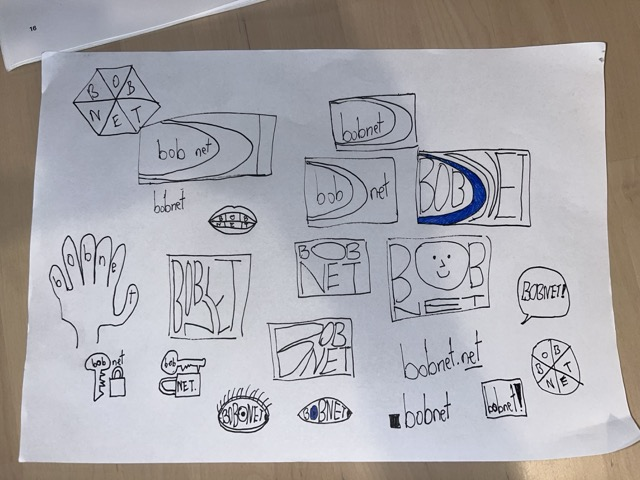

I've been working on [bobnet.nl](https://bobnet.nl/) - this is a kind of "side project container" (SPC?) or "personal web app platform" (PWAP?). It's hosted on Cloudflare.

I noticed that a number of apps I had been building, such as [research together](https://research-together.bobnet.nl/), [summon](https://summon.bobnet.nl/) and [socrates](https://socrates.bobnet.nl/) all revolved around making LLM inference requests. Since these are fundamentally hobby projects, I didn't want to cover the cost of making these requests. A common approach in this case is to let users provide a key in the browser, which is then usually stored in localStorage, e.g. on a site like [backrooms.directory](https://backrooms.directory/). This adds a bit of friction - the user needs to open OpenRouter or some other inference gateway, go into settings, issue an API key, make some kind of decision around budgets and usage limits, and then copy it (should it go in a password manager?) into the app. Given that I want to make a *lot* of apps (why not?), it would be a huge pain for users to have to do this every time. Can I build something that makes this easier? That's when I had the idea for bobnet.

Basically, I wanted single-sign on for my side projects. Users should be able to sign up once with their email address (I'm using the Better Auth library, with magic links), enter in their OpenRouter key *once* (this is handled via [OpenRouter's PKCE flow](https://openrouter.ai/docs/guides/overview/auth/oauth), this is kind of like oAuth but it returns an API key), then use it for all of my apps. The API key is encrypted at rest and users can always revoke it by going into their own OpenRouter settings. The apps themselves don't have direct access to the API key - they make requests to an internal gateway, which injects the key into the request and sends it to OpenRouter. This reduces the potential "blast radius" of any mistakes that I (or Claude) makes while working on the apps themselves. 

Having a shared user identity across my apps is useful for privacy/compliance as well. If a user shares something (like a generated artifact), then they should be able to take it down. If a user sees something that they think is inappropriate, they should be able to report it to a moderator. I'd like to be able to ban users that misbehave. It also gives me a way to communicate with users for marketing purposes, or when the privacy policy changes.

### What's next?

I have a number of things I want to do next:

1. Release a library - right now everything lives in a single monorepo. I think the core (account handling/auth and the internal gateway) could be split into its own open-source repo that anyone can use.
2. Write more - I haven't touched on the architecture or design decisions I made, but I've learned some important lessons
3. Share my process - I used AI to write pretty much of all of bobnet. I don't think Claude or Codex will ever be at a point where it will make sense to "one-shot" anything that could be considered "infrastructure". I'd like to write about how I have ended up approaching things, where I think AI should be used and how to keep it from misbehaving.
